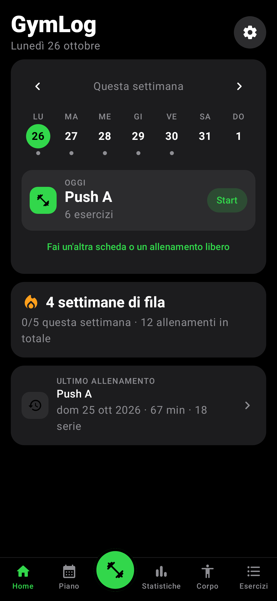
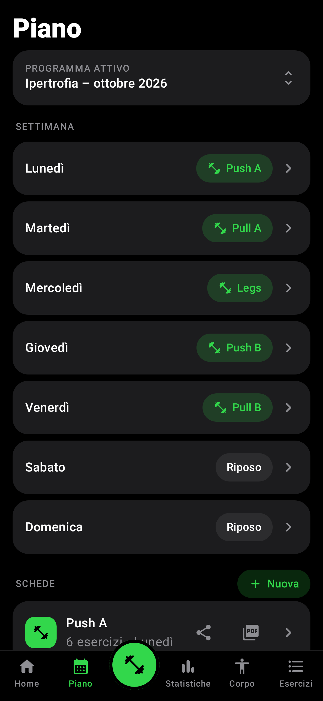
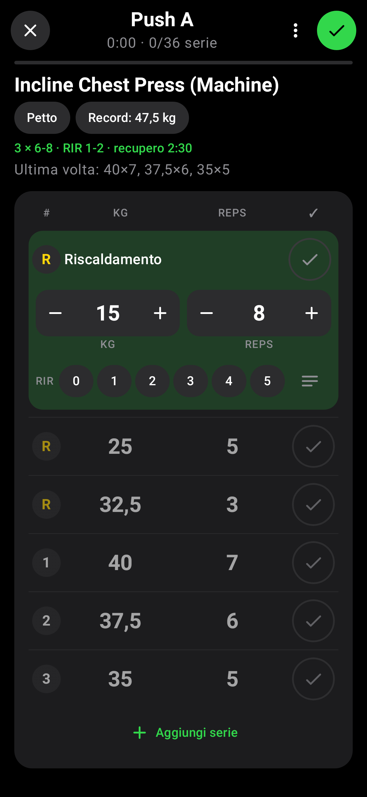
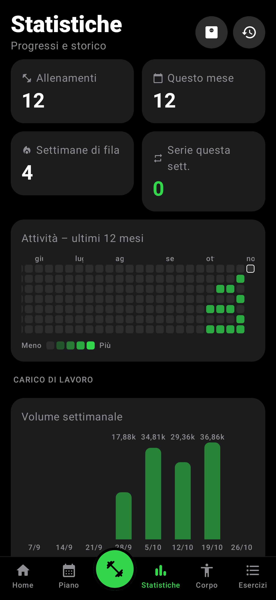
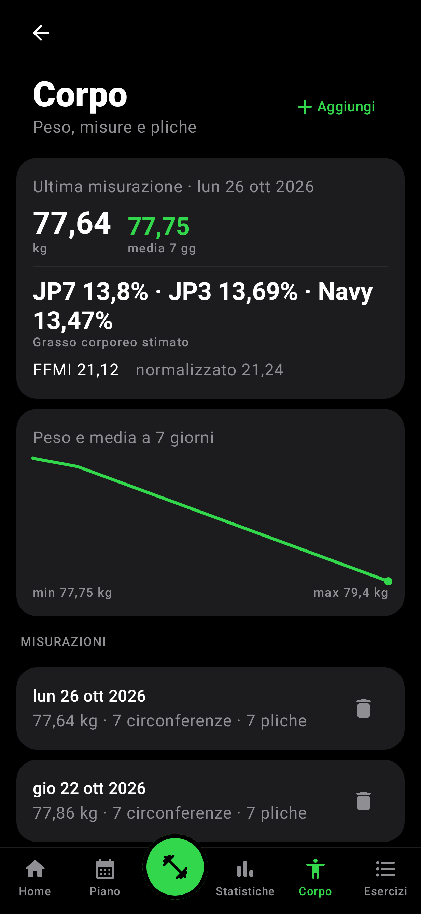
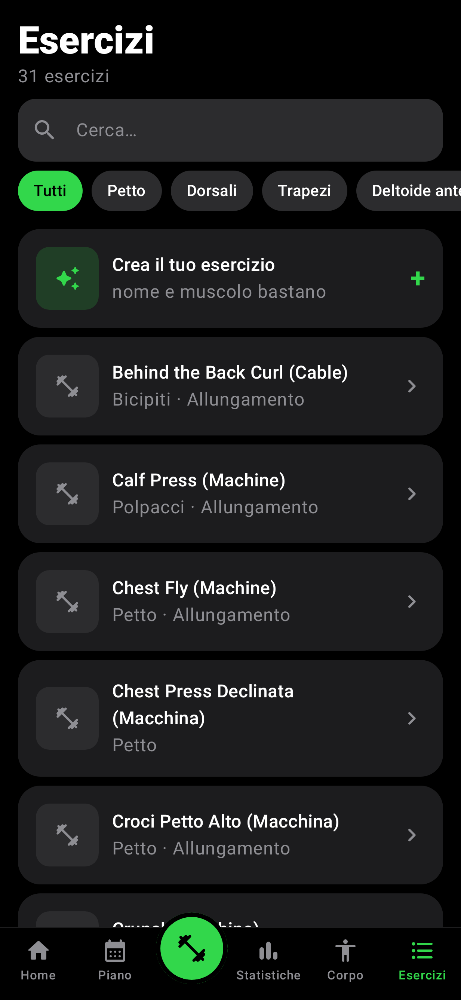
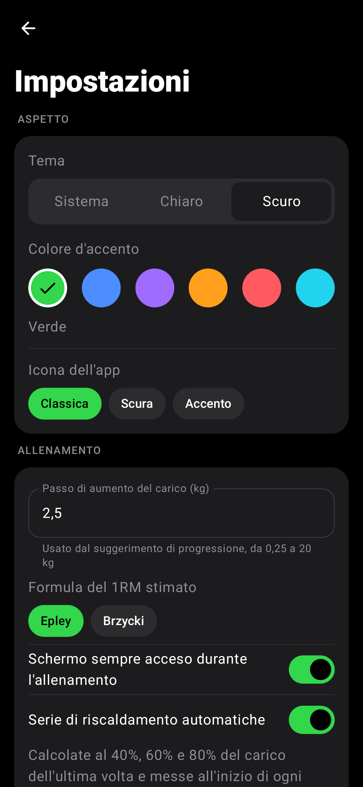

# GymLog

GymLog è un'app Android **offline-first** per pianificare e registrare gli allenamenti in palestra.
È nata come progetto personale: l'interfaccia è in italiano, i carichi sono espressi in chilogrammi
e tutti i dati restano sul telefono.

L'app unisce in un unico posto scheda, diario degli allenamenti, timer di recupero, statistiche,
misurazioni corporee e backup. Non richiede un account e non ha bisogno di una connessione a
Internet per funzionare.

**Versione:** 1.3.0 (`versionCode` 5) · **Android:** 8.0+ (API 26) · **Lingua:** italiano · **Dati:** solo in locale

---

## Screenshot

> Le immagini sono schermate reali dell'interfaccia Compose (nessun mockup), con la scheda
> predefinita "Ipertrofia – ottobre 2026" e alcuni dati di esempio.

| Oggi | Piano | Allenamento |
| :---: | :---: | :---: |
|  |  |  |

| Statistiche | Corpo | Esercizi |
| :---: | :---: | :---: |
|  |  |  |

---

## Indice

- [Screenshot](#screenshot)
- [Funzionalità](#funzionalità)
- [Tecnologie](#tecnologie)
- [Architettura](#architettura)
- [Modello dati](#modello-dati)
- [Logica di allenamento](#logica-di-allenamento)
- [Backup, import ed export](#backup-import-ed-export)
- [Privacy e permessi](#privacy-e-permessi)
- [Build e test](#build-e-test)
- [Struttura del progetto](#struttura-del-progetto)
- [Limiti e note](#limiti-e-note)

---

## Funzionalità

### Oggi

La schermata iniziale risponde alla domanda "che cosa devo fare oggi?".

- Calendario della settimana da lunedì a domenica, con navigazione tra le settimane.
- Indicatori per i giorni con un allenamento concluso, i giorni con una scheda pianificata e i
  giorni di riposo.
- Scheda del giorno selezionato, numero di esercizi e pulsante **Start**.
- Se un allenamento è già in corso, il pulsante diventa **Riprendi**.
- Serie di settimane consecutive con almeno un allenamento, allenamenti della settimana,
  totale storico e ultimo allenamento.
- Accesso rapido alle impostazioni e alla scelta di un'altra scheda o di un allenamento libero.
- Se un allenamento è rimasto aperto da un giorno precedente, l'app chiede se riprenderlo o
  chiuderlo, evitando di falsare la durata.

### Allenamento

La registrazione è pensata per essere veloce tra una serie e l'altra.

- Una pagina per esercizio, con swipe orizzontale e barra di avanzamento.
- Tabella delle serie con kg, ripetizioni, RIR e tipo di serie (riscaldamento, allenante, drop,
  cedimento).
- **Precompilazione** dei carichi e delle ripetizioni dall'ultima sessione dello stesso esercizio.
- **Serie di riscaldamento automatiche** calcolate dal miglior carico dell'ultima volta.
- **Suggerimento di progressione** con doppia progressione: quando tutte le serie raggiungono il
  limite alto di ripetizioni con RIR sufficientemente basso, l'app propone il carico successivo.
- Conferma della serie con ✓, avvio automatico del recupero e possibilità di annullare o correggere
  una serie già salvata.
- **Esercizi unilaterali** con kg, ripetizioni e RIR separati per lato sinistro e destro.
- **Superserie**: gli esercizi con lo stesso numero di gruppo si alternano e il recupero parte solo
  dopo l'ultimo esercizio del gruppo ancora da completare.
- Aggiunta di un esercizio estemporaneo o sostituzione dell'esercizio corrente per la sola sessione.
- Note per serie ed esercizio, foto dell'esercizio scattate durante l'allenamento e modifica rapida
  della scheda dell'esercizio.
- Timer di recupero con aggiunta o sottrazione di 15 secondi e salto.
- Il timer continua a funzionare con l'app in background o lo schermo spento tramite un servizio in
  primo piano, una notifica persistente e un wake lock; a fine recupero arriva una notifica con
  suono e/o vibrazione.
- Possibilità di tenere lo schermo acceso durante l'allenamento.
- Riepilogo finale con durata, serie, volume e record battuti.

### Piano

- Programma attivo con nome, ad esempio **"Ipertrofia – ottobre 2026"**, già precaricato al primo
  avvio.
- Programmazione settimanale: a ogni giorno si può assegnare una scheda oppure lasciare riposo.
- Schede con esercizi, serie target, intervallo di ripetizioni, intervallo RIR, recupero, note e
  superserie.
- Creazione, rinomina ed eliminazione di programmi e schede; cambio del programma attivo.
- Esportazione di una scheda come **testo** o **PDF A4** e condivisione tramite le app di sistema.

### Statistiche

- Allenamenti totali, allenamenti del mese, settimane di fila e serie completate nella settimana.
- Mappa di attività degli ultimi 12 mesi, con quattro livelli di intensità basati sulla durata.
- Allenamenti recenti con accesso al dettaglio della sessione.
- Grafici per esercizio di carico massimo, 1RM stimato e volume.
- Volume settimanale delle ultime 8 settimane.
- Serie allenanti della settimana per muscolo primario.
- Record recenti di 1RM stimato.
- Divario percentuale tra lato sinistro e destro per gli esercizi unilaterali.
- Collegamento diretto alla sezione **Corpo**.

### Corpo

Sezione facoltativa per seguire la composizione corporea.

- Peso e media mobile a 7 giorni.
- Circonferenze: collo, petto, vita, fianchi, braccio, coscia e polpaccio.
- Pliche cutanee: petto, ascellare, tricipite, sottoscapolare, addome, sovrailiaca e coscia.
- Stima del grasso corporeo con **Jackson-Pollock 7 pliche**, **Jackson-Pollock 3 pliche** e
  **US Navy**.
- **FFMI** (indice di massa magra) e FFMI normalizzato a 1,80 m.
- Una misurazione per giorno, modificabile o eliminabile.
- Altezza, anno di nascita e sesso si impostano nelle impostazioni e servono solo per le stime.

### Esercizi

- Libreria di esercizi precaricata, con ricerca e filtro per muscolo.
- Creazione di esercizi personalizzati: bastano nome e muscolo primario.
- Muscoli secondari, note di esecuzione, inclinazione di lunghezza (allungamento/accorciamento) e
  passo di aumento del carico specifico.
- Foto multiple per esercizio, visualizzate anche durante l'allenamento.
- Flag **unilaterale** e **archiviato**.
- Etichetta **"da completare"** per gli esercizi creati automaticamente dall'importazione Hevy.
- Storico e statistiche dedicate per singolo esercizio.

### Storico

- Elenco di tutte le sessioni concluse, con data, durata, numero di serie e origine
  (manuale o importata da Hevy).
- Dettaglio della sessione con esercizi e serie registrate.
- Storico per esercizio con carichi, ripetizioni, RIR e date.
- Accesso ai grafici e ai record del singolo esercizio.

### Impostazioni

- **Aspetto:** tema sistema/chiaro/scuro, colore d'accento (verde, blu, viola, arancione, rosso,
  ciano) e icona dell'app (classica, scura, accento).
- **Allenamento:** passo di aumento del carico (0,25–20 kg), formula del 1RM (Epley o Brzycki),
  riscaldamento automatico, schermo sempre acceso, suono e vibrazione del timer.
- **Corpo:** altezza, anno di nascita e sesso, usati per grasso stimato e FFMI.
- **Dati:** importazione da Hevy, esportazione CSV di tutte le serie, export/ripristino del backup
  completo e backup automatico settimanale in una cartella scelta.

<p align="center">
  
</p>

### Widget e notifiche

- Widget della home che mostra l'allenamento in corso oppure la scheda di oggi; toccandolo si apre
  l'app.
- Canali di notifica separati per recupero in corso e fine recupero (con o senza suono).
- Il servizio del timer è dichiarato come `specialUse` e viene fermato quando il recupero termina o
  viene saltato.

---

## Tecnologie

| Area | Scelta | Versione |
| --- | --- | --- |
| Linguaggio | Kotlin | 2.1.0 |
| UI | Jetpack Compose + Material 3 | BOM 2024.12.01 |
| Icone | Material Icons Extended | BOM Compose |
| Navigazione | Navigation Compose | 2.8.5 |
| Activity | Activity Compose | 1.9.3 |
| Ciclo di vita | Lifecycle Runtime/ViewModel Compose | 2.8.7 |
| Persistenza | Room + KSP | 2.6.1 |
| Preferenze | DataStore Preferences | 1.1.1 |
| Immagini | Coil Compose | 2.7.0 |
| Async | Kotlin Coroutines + Flow/StateFlow | 1.9.0 |
| Timer | Foreground Service + NotificationCompat + WakeLock | AndroidX Core 1.15.0 |
| Widget | AppWidgetProvider + RemoteViews | Android SDK |
| Build | Android Gradle Plugin / Gradle | 8.7.3 / 8.11.1 |
| Java/JVM | Java 17 | — |
| SDK | min 26, target/compile 35 | — |
| Test | JUnit 4, Robolectric, Room Testing, coroutines-test | Robolectric 4.14.1 |

L'app non usa librerie di rete, backend, Firebase o servizi cloud: tutte le operazioni avvengono sul
dispositivo.

---

## Architettura

GymLog è un progetto Android a modulo singolo, organizzato per responsabilità:

```text
┌──────────────────────────────────────────────────────────────┐
│                      Jetpack Compose UI                      │
│  Home · Piano · Allenamento · Statistiche · Corpo · Esercizi │
└──────────────────────────────┬───────────────────────────────┘
                               │ StateFlow / eventi
┌──────────────────────────────▼───────────────────────────────┐
│                         ViewModel                            │
│  stato della schermata, azioni utente, orchestrazione        │
└──────────────────────────────┬───────────────────────────────┘
                               │
┌──────────────────────────────▼───────────────────────────────┐
│                       Repository                             │
│  Workout · Program · Exercise · Body · Settings · Backup      │
└───────────────┬──────────────────────────────┬───────────────┘
                │                              │
┌───────────────▼──────────────┐  ┌────────────▼───────────────┐
│  Room (SQLite) + migrazioni  │  │ DataStore (preferenze)     │
│  esercizi, schede, sessioni  │  │ tema, timer, backup, corpo │
│  serie, misurazioni          │  │                            │
└──────────────────────────────┘  └────────────────────────────┘
                │
┌───────────────▼──────────────────────────────────────────────┐
│  Servizi di piattaforma                                      │
│  RestTimerService · GymWidgetProvider · FileProvider · PDF   │
└──────────────────────────────────────────────────────────────┘
```

- **Dependency injection manuale:** `AppContainer` crea database, repository, timer e servizi una
  sola volta all'avvio dell'`Application`. Non vengono usati Hilt o Koin.
- **MVVM:** le schermate Compose osservano uno `StateFlow` esposto dal rispettivo ViewModel e
  inviano azioni a quest'ultimo. I ViewModel usano i repository, non i DAO direttamente.
- **Flussi reattivi:** Room e DataStore emettono `Flow`; lo stato della UI si aggiorna da solo dopo
  una modifica al database o alle preferenze.
- **Navigazione:** `AppNavHost` definisce le rotte con Navigation Compose. La barra inferiore è
  visibile solo sulle schermate principali (Oggi, Piano, Statistiche, Corpo, Esercizi); le schermate
  di dettaglio e l'allenamento hanno navigazione propria.
- **Avvio:** `GymLogApp` crea `AppContainer`, applica l'icona scelta e, se il database è vuoto,
  inserisce la libreria e la scheda predefinita (`SeedData`). Un backup automatico viene eseguito
  se sono passati almeno 7 giorni dall'ultimo.
- **Timer:** `RestTimerImpl` conserva un istante di fine assoluto, quindi il conto alla rovescia
  resta corretto anche quando l'app non è in primo piano. Il servizio in primo piano mostra la
  notifica e mantiene attivo il dispositivo fino alla fine del recupero.
- **Widget:** legge il database in background e aggiorna le `RemoteViews`; viene rinfrescato quando
  l'app torna visibile.

---

## Modello dati

Il database Room `gymlog.db` è alla versione **3** e ha migrazioni esplicite `1 → 2` e `2 → 3`.

| Tabella | Contenuto |
| --- | --- |
| `Exercise` | Esercizio della libreria: nome, muscolo primario, inclinazione di lunghezza, note, passo di carico, flag unilaterale/archiviato/da completare, nome Hevy. |
| `ExerciseSecondaryMuscle` | Muscoli secondari di un esercizio (relazione molti-a-molti). |
| `ExercisePhoto` | Foto dell'esercizio: percorso del file e ordinamento. I file sono nella directory privata dell'app. |
| `Program` | Programma di allenamento; uno solo è attivo. |
| `RoutineDay` | Scheda/giorno del programma, con nome, giorno della settimana opzionale e ordinamento. |
| `RoutineExercise` | Esercizio dentro una scheda: serie target, ripetizioni min/max, RIR min/max, recupero, note, superserie. |
| `WorkoutSession` | Sessione: titolo, inizio, fine (`null` = in corso), note, origine manuale/Hevy. |
| `SetEntry` | Serie registrata: esercizio, ordine, indice, tipo, kg, ripetizioni, RIR, note, data di conferma e lati destro/sinistro per gli esercizi unilaterali. |
| `BodyEntry` | Misurazione giornaliera: peso, circonferenze, pliche, note; indice univoco sul giorno. |

Relazioni principali:

- un `Program` ha molti `RoutineDay`;
- un `RoutineDay` ha molti `RoutineExercise`;
- una `WorkoutSession` ha molte `SetEntry`;
- un `Exercise` può comparire in più schede, sessioni e foto;
- `BodyEntry` è indipendente dalle sessioni ed è identificata dal giorno.

Le migrazioni aggiungono solo colonne o tabelle, senza riscrivere i dati esistenti. Gli schemi
esportati da Room sono in `app/schemas/` e vengono usati dai test di migrazione.

---

## Logica di allenamento

### Precompilazione delle serie

Quando si apre un esercizio, GymLog recupera le serie dell'ultima sessione e le propone come punto
di partenza. Se le serie allenanti sono meno di quelle previste dalla scheda, vengono aggiunte copie
dell'ultima serie allenante. In questo modo la tabella è già pronta e l'utente deve correggere solo
ciò che cambia.

### Riscaldamento automatico

Se l'opzione è attiva, l'app calcola tre serie di riscaldamento dal miglior carico allenante
dell'ultima volta:

- 40% × 8 ripetizioni
- 60% × 5 ripetizioni
- 80% × 3 ripetizioni

I carichi vengono arrotondati al passo dell'esercizio (o al passo predefinito) e le serie uguali o
superiori al carico di lavoro vengono scartate. Per gli esercizi unilaterali il lato destro parte
uguale al sinistro.

### Doppia progressione

Il suggerimento di carico confronta l'ultima sessione con il target della scheda. Se tutte le serie
allenanti hanno raggiunto il numero massimo di ripetizioni con RIR minore o uguale al massimo
previsto, l'app propone il carico minimo usato più il passo di aumento. In caso contrario non
propone nulla: prima si consolidano ripetizioni e tecnica.

### Metriche

- **1RM stimato:** formula di Epley (`kg × (1 + reps/30)`) oppure Brzycki (`kg × 36 / (37 - reps)`),
  selezionabile nelle impostazioni. Con una sola ripetizione il valore è il carico stesso.
- **Volume:** `kg × ripetizioni`; per gli esercizi unilaterali viene sommato il volume di entrambi i
  lati.
- **Record:** ogni nuovo massimo di 1RM stimato per esercizio, ordinato per data.
- **Asimmetria:** differenza percentuale del miglior carico destro rispetto al sinistro
  nell'ultima sessione.
- **Serie per muscolo:** una serie vale 1 per il muscolo primario e 0,5 per ogni muscolo secondario;
  le serie di riscaldamento non contano.
- **Streak:** settimane consecutive (lunedì–domenica) con almeno un allenamento; la settimana in
  corso non interrompe la serie se è ancora vuota.
- **Mappa attività:** livello 1–4 per ogni giorno con almeno un allenamento, in base ai minuti
  totali (≤ 30, ≤ 60, ≤ 90, > 90).
- **Volume settimanale:** somma del volume delle serie nelle ultime 8 settimane.
- **Grasso corporeo:** Jackson-Pollock 7, Jackson-Pollock 3 e US Navy, con formula di Siri per la
  densità; i risultati fuori dall'intervallo 2–70% vengono scartati.
- **FFMI:** massa magra divisa per l'altezza al quadrato, con versione normalizzata a 1,80 m.

---

## Backup, import ed export

### Backup completo

Da **Impostazioni → Backup** si può creare uno ZIP con:

- database Room;
- foto degli esercizi;
- impostazioni dell'app.

Il ripristino sostituisce i file, chiude il database, salva una copia di sicurezza e richiede il
riavvio dell'app. Prima dell'operazione viene chiesta conferma. È disponibile anche il **backup
automatico settimanale** in una cartella scelta tramite il selettore di sistema (Storage Access
Framework), con permesso persistente.

### Importazione da Hevy

L'importazione legge il CSV esportato da Hevy e:

- crea le sessioni mancanti, saltando quelle già presenti;
- collega gli esercizi per nome, creando quelli sconosciuti con l'etichetta **"da completare"**;
- importa serie, pesi, ripetizioni, RIR, note e tipi di serie;
- riporta un riepilogo con sessioni importate, saltate, esercizi nuovi e righe non valide.

L'importazione è ripetibile: non duplica gli allenamenti già importati.

### Export

- **CSV di tutte le serie**, utile per analisi in un foglio di calcolo.
- **Testo/PDF di una singola scheda**, con esercizi, serie, ripetizioni, RIR, recupero, note e
  superserie.
- Condivisione tramite le app di sistema (file temporaneo esposto con `FileProvider`).

---

## Privacy e permessi

- I dati sono salvati nel database Room, nei file privati dell'app e in DataStore; non vengono
  inviati a server.
- Il manifest non dichiara il permesso `INTERNET`.
- Non ci sono account, analytics, pubblicità o tracciamento.
- Il backup ZIP è creato solo su richiesta dell'utente e nella destinazione scelta.
- Il manifest abilita il backup di sistema di Android (`allowBackup="true"`): i dati possono essere
  inclusi nel backup gestito dal sistema operativo, fuori dal controllo dell'app.
- Permessi dichiarati:
  - `POST_NOTIFICATIONS` per il timer di recupero (Android 13+);
  - `FOREGROUND_SERVICE` e `FOREGROUND_SERVICE_SPECIAL_USE` per il servizio del timer;
  - `VIBRATE` per la vibrazione a fine recupero;
  - `WAKE_LOCK` per mantenere attivo il dispositivo durante il conto alla rovescia.
- La fotocamera viene aperta tramite l'app di sistema con `FileProvider`; GymLog non richiede il
  permesso `CAMERA`.
- Disinstallando l'app i dati locali vengono rimossi; se il backup di sistema è attivo, Android
  potrebbe ripristinarne una copia. È comunque consigliato esportare un backup ZIP prima di
  disinstallare o cambiare telefono.

---

## Build e test

### Requisiti

- JDK 17;
- Android SDK con Platform 35 e Build Tools;
- `local.properties` con `sdk.dir` (non versionato);
- per l'APK firmato, `keystore.properties` e il keystore (non versionati).

### Comandi utili

```bash
# Test JVM (Robolectric + Room in memoria)
scripts/test.sh

# Test con output Gradle completo
./gradlew testDebugUnitTest

# Analisi statica Android
./gradlew lintDebug

# Build dell'APK release firmato e copia in dist/
scripts/build-apk.sh
```

`scripts/build-apk.sh` esegue `clean`, i test e `assembleRelease`, verifica la firma e copia il file
in `dist/GymLog-<versione>.apk`. La suite attuale conta **183 test JVM**.

L'APK pronto per l'installazione è `dist/GymLog-1.3.0.apk`. Per installarlo e aggiornarlo sul
telefono segui [INSTALLA.md](INSTALLA.md).

### Firma

La configurazione release legge `keystore.properties` dalla root del progetto. Il file e il
keystore sono esclusi dal repository: senza la stessa chiave non è possibile installare un
aggiornamento sopra la versione precedente. Non committare mai password o file `.jks`.

---

## Struttura del progetto

```text
GymLog/
├── app/
│   ├── schemas/                  # schemi Room esportati (test di migrazione)
│   ├── src/main/
│   │   ├── AndroidManifest.xml
│   │   ├── java/it/gymlog/app/
│   │   │   ├── AppContainer.kt          # dependency injection manuale
│   │   │   ├── GymLogApp.kt             # Application
│   │   │   ├── MainActivity.kt
│   │   │   ├── data/
│   │   │   │   ├── backup/              # ZIP completo, CSV, ripristino
│   │   │   │   ├── db/                  # entità, DAO, relazioni, migrazioni, seed
│   │   │   │   ├── export/              # testo e PDF della scheda
│   │   │   │   ├── hevy/                # parser e importatore CSV
│   │   │   │   ├── repo/                # repository di dominio
│   │   │   │   └── settings/            # DataStore, tema, icone
│   │   │   ├── domain/                  # algoritmi puri e modelli di calcolo
│   │   │   ├── timer/                   # timer e foreground service
│   │   │   ├── ui/                      # schermate Compose, ViewModel, tema
│   │   │   └── widget/                  # widget della home
│   │   └── res/                         # risorse, layout widget, icone
│   └── src/test/                        # test JVM e risorse di test
├── dist/                         # APK generati
├── docs/                         # specifiche di design e screenshot
├── gradle/                       # version catalog e wrapper
├── scripts/                      # test.sh, build-apk.sh, env.sh
├── INSTALLA.md                   # guida installazione/aggiornamento per il telefono
└── README.md
```

---

## Limiti e note

- È un progetto personale, pensato per un singolo utente e per l'uso in palestra; non è pubblicato
  sul Play Store.
- L'interfaccia e i messaggi sono in italiano; i carichi sono solo in kg.
- Non esiste sincronizzazione cloud o multi-dispositivo: il backup ZIP è il modo previsto per
  spostare i dati.
- L'allenamento libero e le schede sono gestiti localmente; non c'è integrazione con wearable o
  con altre app oltre all'importazione del CSV di Hevy.
- Il PDF della scheda è generato con `PdfDocument` ed è volutamente semplice (testo e impaginazione
  A4), non un layout grafico.
- Le stime di grasso corporeo e FFMI sono indicatori, non diagnosi mediche.

## Documentazione collegata

- [INSTALLA.md](INSTALLA.md) – installazione, aggiornamenti, backup e checklist della versione 1.3.0.
- [docs/superpowers/specs](docs/superpowers/specs) – specifiche di design del progetto.

## Licenza

Il repository non contiene un file di licenza: il progetto è personale e non è accompagnato da una
licenza open source esplicita.
